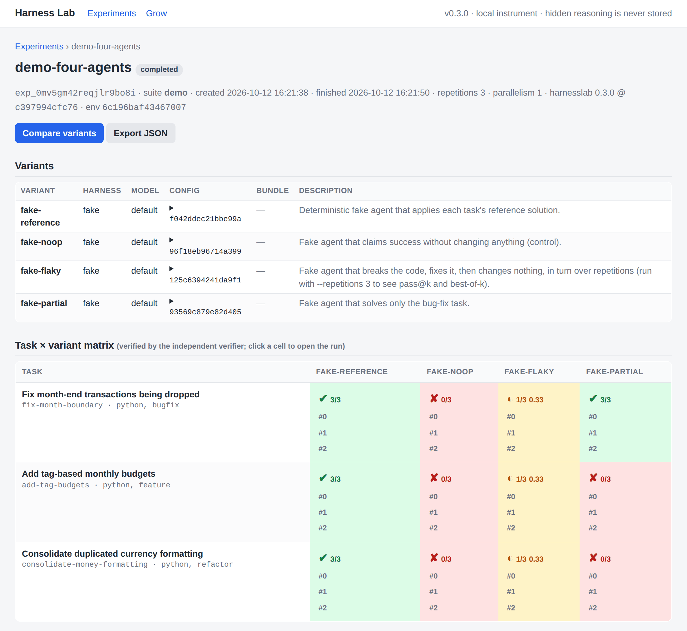

<!-- The landing page uses Material-only syntax, so it is the one page GitBook does not show;
GitBook opens on start/overview.md. tests/test_docs.py keeps it that way. -->

<div class="hl-home" markdown>

<div class="hl-hero" markdown>

# Harness Lab

Controlled experiments for AI coding-agent harnesses.
{ .hl-tagline }

Run the same task, from the same commit, through Claude Code, Codex, OpenCode, pi, Hermes Agent
or your own agent. Hidden tests decide what passed; cost, tokens, LLM calls and behaviour sit side
by side.
{ .hl-lede }

```bash
pip install harnesslab
harnesslab run demo --variants fake-reference,fake-noop
harnesslab serve
```

The demo runs offline fake agents: no API key, done in seconds.
{ .hl-note }

[Get started](start/quickstart.md){ .md-button .md-button--primary }
[Take the tour](start/tour.md){ .md-button }
[:fontawesome-brands-github: GitHub](https://github.com/bilgin-kocak/harness-lab){ .md-button }

</div>

[{ .hl-shot width="1100" height="1010" }](start/tour.md)

## The problem it solves

**Which AI coding-agent setup actually works best on your code, and at what cost?**
{ .hl-question }

An AI coding agent is two things: the **model** (Claude, GPT, …) and the **harness** around it,
the program that drives the model (Claude Code, the Codex CLI, OpenCode, …) with its system prompt,
tools, settings, skills and hooks. Teams pay for both, yet rarely know which combination works
on their code, because the usual comparisons are unreliable:
{ .hl-intro }

<div class="grid cards" markdown>

-   :material-gavel:{ .lg .middle } __The agent grades itself__

    ---

    It says "done, all tests pass", and sometimes that is not true; some agents even edit the
    tests so that they pass.

    **Harness Lab:** hidden tests, injected after the agent finishes, decide pass or fail.

-   :material-source-commit:{ .lg .middle } __Comparisons are not fair__

    ---

    Different starting code, different tasks, one lucky run.

    **Harness Lab:** every run starts from the same commit in its own copy, and repeated runs
    with paired statistics say whether a difference is real.

-   :material-layers-outline:{ .lg .middle } __Model and harness get mixed up__

    ---

    A setup does better, and nobody knows whether the model or the harness did it.

    **Harness Lab:** the model, the CLI version and every setting are recorded separately, so
    each can be changed on its own.

-   :material-cash-multiple:{ .lg .middle } __Cost is ignored__

    ---

    Two setups solve the same tasks, and one of them costs many times more.

    **Harness Lab:** cost, tokens, LLM calls and time sit next to success, and a sweep finds the
    cheapest setup that still passes.

-   :material-update:{ .lg .middle } __Things change underneath you__

    ---

    New CLI releases every week, new models, edited instructions: did the change help or hurt?

    **Harness Lab:** run the same tasks before you upgrade or merge, and compare.

-   :material-source-repository:{ .lg .middle } __Benchmarks are not your code__

    ---

    Public leaderboards measure someone else's tasks.

    **Harness Lab:** `suite mine` turns your own git history into tasks with hidden tests.

</div>

!!! example "What an answer looks like (made-up numbers)"

    Your team uses Claude Code and asks: Opus or Sonnet? High or medium reasoning effort? Do our
    custom instructions help? Harness Lab mines 50 tasks from your repository's history, runs
    every setup three times on each task, checks every result with the hidden tests, and reports
    something like: *Sonnet at medium effort passes 84% at $0.40 a task and Opus 86% at $1.90;
    the 2-point difference is not significant, so use Sonnet. Dropping the custom instructions
    changes nothing.*

In short: A/B testing for AI coding agents, so that choices of agent, model, settings and
instructions rest on evidence instead of guesses.
{ .hl-intro }

## How it works

<div class="hl-steps" markdown>

1. **Task suite**<br>a prompt, a repository commit and hidden tests
2. **Isolated runs**<br>one git worktree of that commit per run, for every harness
3. **Independent verifier**<br>hidden tests injected after the agent exits
4. **Normalized trace**<br>events, diff, tokens, cost and LLM calls in one schema
5. **Evidence**<br>the matrix, paired statistics, sweeps, grow, ablation, export

</div>

## What you can do

<div class="grid cards" markdown>

-   :material-source-branch:{ .lg .middle } __Build benchmarks from your code__

    ---

    Write tasks in YAML, or mine them from git history: commits that changed code together with
    its tests become tasks whose tests stay hidden.

    [:octicons-arrow-right-24: Write a task suite](guides/task-suites.md) ·
    [Mine git history](guides/task-corpus.md)

-   :material-tune-variant:{ .lg .middle } __Find the cheapest setup that passes__

    ---

    Sweep model × reasoning effort × tools × compaction × action granularity × bundle and get
    the cheapest configuration that still passes, with its Pareto front.

    [:octicons-arrow-right-24: Configuration sweeps](guides/sweeps.md)

-   :material-sprout-outline:{ .lg .middle } __Grow a harness from its failures__

    ---

    An optimizer edits a bundle's prompt, skills and hooks; an edit stays only when it fixes
    failures and a held-out gate does not regress.

    [:octicons-arrow-right-24: Grow the harness](guides/growing.md)

-   :material-puzzle-check-outline:{ .lg .middle } __Prove each component helps__

    ---

    An ablation tests every part of a bundle against its own absence, and gives a verdict only
    from enough tasks.

    [:octicons-arrow-right-24: Ablate a harness](guides/ablation.md)

-   :material-shield-check-outline:{ .lg .middle } __Measure more than pass/fail__

    ---

    Risky actions and a sentinel hook to A/B test, rounds against a measured objective,
    find-everything tasks, recovery from injected faults, pass@k and best-of-k.

    [:octicons-arrow-right-24: Safety](guides/safety.md) · [Improvement](guides/improvement.md) ·
    [Find-everything](guides/discovery.md) · [Recovery](guides/recovery.md)

-   :material-view-dashboard-outline:{ .lg .middle } __Read the evidence__

    ---

    A local dashboard with the task × variant matrix, run timelines, diffs and verifier output,
    and a JSON export of everything.

    [:octicons-arrow-right-24: The dashboard](guides/dashboard.md) ·
    [Results and statistics](guides/results.md)

</div>

## When to use it

<div class="hl-uses" markdown>

- **Before upgrading a model or a CLI.** Run your tasks on both, side by side: a variant's
  `executable` can point at the old binary and another at the new one.
- **Before merging a prompt, skill or hook change.** Keep a change only when the paired evidence
  says it helps, and drop the parts an ablation shows do nothing.
- **When choosing an agent for your codebase.** Compare harnesses on tasks mined from your own
  history, not on someone else's benchmark.
- **When agent costs climb.** A sweep finds the cheapest configuration that still passes your
  tasks.
- **Before trusting a safety policy.** See which risky actions each setup takes, and whether a
  hook blocks them without costing success.
- **For research on harnesses.** Model and harness are independent variables, raw evidence is
  kept, and every experiment exports to JSON.

</div>

## Supported harnesses

| Harness | `runner` | What Harness Lab records |
| --- | --- | --- |
| Claude Code CLI | `claude` | Full trace, reported cost, LLM calls; bundles load as a plugin (prompt, skills, hooks, agents) |
| OpenAI Codex CLI | `codex` | Full trace; cost from your [pricing table](reference/pricing.md); a bundle's prompt and skills become instructions |
| [OpenCode](guides/opencode.md) 1.x and 2.x *(unreleased)* | `opencode` | Full trace, reported cost, LLM calls; injected permission policy; bundles as global rules and skills |
| [pi](guides/pi.md) *(unreleased)* | `pi` | Full trace, reported cost, LLM calls; runs only with an explicit opt-in, since pi has no permission system |
| [Hermes Agent](guides/hermes.md) *(unreleased)* | `hermes` | Trace, cost and LLM calls from its session store; manual approvals that refuse dangerous commands |
| Any command-line agent | `generic` | Diff and verdict for any command; a full trace with the [JSONL event protocol](guides/your-own-harness.md#the-jsonl-event-protocol) |
| Your Python adapter | your own | Whatever your [`HarnessRunner`](guides/your-own-harness.md#2-a-python-module-a-real-adapter) emits, registered directly or as an entry point |
| Fake agent | `fake` | Deterministic and offline: demos, tests and CI without an API key |

## Research principles

<div class="hl-uses" markdown>

- **Model and harness are independent variables**, recorded separately on every run.
- **Component ablations over framework-versus-framework comparisons.**
- **Verification is external**: the agent's "done" is a message, never a result.
- **Raw evidence is preserved**: traces, diffs and verifier output, per run.
- **Pareto frontiers, not one score.**
- **Reproducibility**: hashes, base commit, CLI version and environment with every run.

</div>

[Why these principles](explanations/research-principles.md){ .md-button }
{ .hl-center }

!!! warning "Agents run on your machine"

    Runs are isolated with git worktrees, not containers: an agent has your user's access. Use
    repositories you trust and credentials you can revoke. Read the
    [security model](explanations/security-model.md) and the [honest limits](explanations/limits.md).

## Cite Harness Lab

```bibtex
@software{kocak_harness_lab,
  author  = {Kocak, Bilgin},
  title   = {Harness Lab: controlled experiments for AI coding-agent harnesses},
  version = {0.3.0},
  year    = {2026},
  url     = {https://github.com/bilgin-kocak/harness-lab},
  license = {MIT}
}
```

GitHub's *Cite this repository* reads the same data from
[CITATION.cff](https://github.com/bilgin-kocak/harness-lab/blob/main/CITATION.cff).

<div class="hl-links" markdown>

[Install](start/install.md) · [Quickstart](start/quickstart.md) · [Tour](start/tour.md) ·
[Changelog](project/changelog.md) · [Roadmap](project/roadmap.md) ·
[Contributing](project/contributing.md) · [PyPI](https://pypi.org/project/harnesslab/) ·
MIT License

Harness Lab is an independent open-source project, not affiliated with Anthropic or OpenAI.

</div>

</div>
