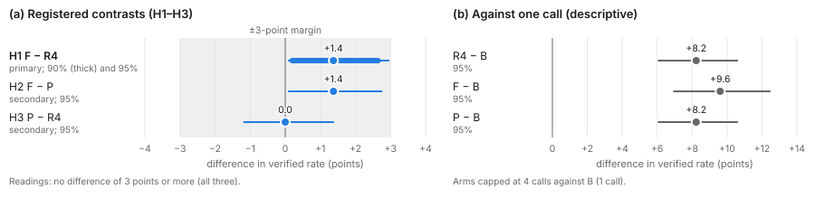
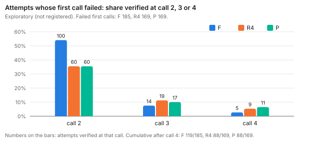
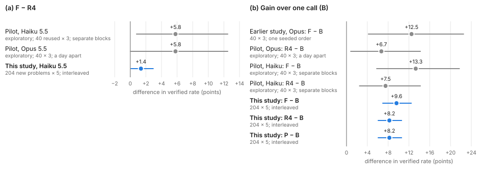

# Feedback or just another try? A pre-registered test of Lean's error report against fresh tries, with Claude Haiku 5.5 on miniF2F

**[Authors and affiliations: owner to fill in]**

> **Status: draft for the owner, 2026-11-26. Not published, not submitted, not for circulation.**
> Every claim needs the owner's approval before it leaves this repository (see "Claims the owner
> must approve" in `OUTLINE.md`). Numbers come from `../analysis.json` (the registered output),
> `../RESULTS.md`, `../d1_report.md` and `../d1_report.json`, the re-check files named in the text,
> the pilot's report and the earlier study's report. Everything not produced by `analyze.py` run
> unchanged is marked *exploratory (not registered)*; none of it changes a registered reading.
> Every citation was checked against its source by two agents (`REFERENCES_CHECK.md`).

## Abstract

Showing a language model its failed proof with the proof checker's error messages is common in
LLM theorem proving, but its gain is not always separated from that of simply trying again. We ask
whether Lean's report helps beyond fresh tries at the same cap of calls. In a pre-registered
study, Claude Haiku 5.5 attempted 204 miniF2F problems in Lean 4, five times each, in four
interleaved arms: one call (B); up to four calls, each after the first showing the attempt's earlier
failed proofs with Lean's report on each (F); up to four fresh tries (R4); and a placebo like F with
Lean's report replaced by a fixed rejection sentence (P). F verified 93.43% of attempts and R4 92.06%: +1.4 points (90% CI +0.20 to +2.65; sign-flip
p = 0.093), which the registered rule reads as no difference of 3 points or more in the overall
verified rate; descriptively, F's unverified share was about 17% smaller than R4's (95% CI 1% to
38%; not a test). F versus P (+1.4, Holm p = 0.125) and P versus R4 (0.0) read the same way. Arms capped at four calls (1.3 to
1.4 used on average) verified 8 to 10 points more than one call (descriptive). An exploratory pilot had estimated
+5.8 points for F over R4; our 90% interval excludes it and the +4.1 points the study was powered
for. Out-of-memory events ended 19 of the 4,080 final checks, 17 of them on one problem no arm
proved; under the registered rule every reading stands. A reading would change only if one of F's
proofs of that problem had passed, and exploratory re-checks indicate that very likely none could have
within the registered 300 s limit, even with enough memory. Code, records, transcripts and
analysis will be released with the paper.

## 1. Introduction

Language models that write formal proofs are often run in a repair loop. When the proof checker
rejects a proof, the model is shown the failed proof with the checker's error messages and tries
again (Lin et al., 2025; Wang et al., 2025). Such loops are usually credited with gains measured
against a single call. That comparison mixes two things: what the checker's report tells the
model, and the extra calls the loop makes. A model that is simply sampled again, with no feedback
at all, also gets more chances, and coverage improves smoothly with the number of independent
samples, Lean proofs included (Brown et al., 2024). Our own earlier study is an example: a loop
showing Lean's report, with up to four calls, verified 97.5% of Claude Opus 5.5's attempts on 40
miniF2F problems against 85.0% for one call, but because the loop could make up to four calls and the
baseline one, the comparison could not separate feedback from extra calls (Harness Lab, 2026).

Comparisons matched on calls or samples exist, and they disagree. A call-matched comparison of
refinement with resampling across 14 models found refinement ahead on average on a 50-problem
miniF2F subset and behind on average on a miniCTX subset (Klingner et al., 2026). With two open models on
difficult miniF2F problems, no tested feedback condition established an advantage over
instruction-only resampling (Li and Li, 2026). Repair gains at matched sample counts have been
reported in Isabelle/HOL (First et al., 2023) and, self-reported, for a Lean prover trained to fix
errors (Wang et al., 2025). In code generation, self-repair's gains are often modest once its cost
is counted (Olausson et al., 2024).

We ask two questions. At a matched cap of four model calls, does showing the model its failed proof
with Lean's report change how often its attempts verify, compared with fresh tries? And if it does,
is that because of Lean's report, or because the model sees its failed proof? We answer them for
one current API model, Claude Haiku 5.5, on the 204 miniF2F test problems we had never run.

Our contributions are:

1. **A pre-registered comparison at a matched cap of four calls, with a placebo arm.** Four arms
   (one call; feedback; fresh tries; the earlier failed proofs with a fixed rejection sentence) ran on 204
   problems with five repetitions each: 4,080 attempts in one seeded, interleaved order. The
   hypotheses, estimands, analysis script and reading rules were committed before any paid call,
   and the analysis is exact where it can be.
2. **The answer for this setup.** The registered reading is "no difference of 3 points or more in
   the overall verified rate" between feedback and fresh tries, with a small positive estimate
   (+1.4 points), and nothing is attributed to Lean's report.
3. **A worked case of an estimate that shrank.** Our exploratory pilot, on 40 reused problems with
   arms run in separate time blocks, had put feedback 5.8 points above fresh tries. The larger,
   pre-registered and interleaved study on 204 new problems estimates +1.4, and its 90% interval
   excludes both the pilot's estimate and the +4.1 points the study was powered for. We also show
   why our earlier comparison with one call could not separate feedback from extra calls.
4. **An account of out-of-memory kills on the checking machine,** handled under rules fixed before
   the outcomes were seen (a killed check is not a pass), bounded, recounted and reported, with the
   lessons for anyone building such a harness.

## 2. Related work

**Refinement against resampling at matched calls.** Klingner et al. (2026) compare refine@k, in
which a model whose proof fails is re-prompted with that proof and the Lean verifier's error trace
for up to k turns, with pass@k, k independent samples. Across 14 models, Δ_32 = refine@32 −
pass@32 averages +7.7 points on a 50-problem miniF2F subset and −1.4 points on a 50-problem miniCTX
subset, from a single refine run that the authors call a snapshot rather than a statistical
estimate. (We use the values of their Table 3.1; their text's counts of models with a positive
Δ_32 differ from it.) The design is closely related to ours. It differs in the cap (32 calls
against 4), in having one run per problem, and in having no placebo arm or pre-registration.

**Feedback conditions against resampling, pre-registered.** Li and Li (2026) test Qwen3.6-27B and
DeepSeek-Prover-V2-7B on difficult miniF2F test problems, with a pre-registered primary endpoint.
No tested one-step feedback condition established an advantage over instruction-only resampling,
nor did sequential repair at 64 attempts: on Qwen the pre-registered comparison of repair with
retrying was unresolved (−18.3 points, 95% interval −41.8 to +5.3), and on DeepSeek-Prover-V2-7B
repair was clearly worse (−50.7 points). Showing the model its failed predecessor without a
diagnostic reduced success, and on Qwen adding that attempt's compiler error recovered the loss and
beat controls that showed another problem's error. Their failed-predecessor condition is the
closest counterpart of our P, which adds only a fixed rejection sentence, and their compiler-error
condition of our F; their wrong-diagnostic controls have no counterpart here. With a different
model, and on problems most of which every arm solved every time, our P against fresh tries read "no
difference of 3 points or more" (H3: 0.0 points, 95% interval −1.18 to +1.37).

**Repair at matched samples.** In Python code generation, Olausson et al. (2024) compare self-repair
with independent sampling at a matched number of sampled programs and find that once the cost of
repair is counted, gains "are often modest, vary a lot between subsets of the data, and are
sometimes not present at all". Baldur (First et al., 2023), in Isabelle/HOL, proves 36.3% of the
PISA test theorems with generation plus repair against 34.8% with generation alone at 16 samples,
the repair arm using half the samples and one repair attempt each, with a separately fine-tuned
repair model. A self-reported blog post on Kimina-Prover (Wang et al., 2025), a model trained to fix
errors from Lean's feedback, gives 35.6% for 16 attempts each followed by one fix, against 28.8% for
32 independent attempts, on 59 miniF2F-test problems selected for their low win rates; neither study
reports variance. Goedel-Prover-V2 (Lin et al., 2025) ablates the compiler's error messages from its
trained self-correction loop and finds that revising without them gains less on miniF2F-test at
pass@32. The ablation removes the messages rather than replacing them with an uninformative one, and
it has no arm of fresh samples matched on calls (the conference version compares with plain
sampling on output tokens). Revising without the messages is analogous to our P, and the ablation
to our F − P contrast, except that P replaces Lean's report with a fixed sentence instead of
removing it.

**Self-correction and repeated sampling.** Huang et al. (2024) find that intrinsic self-correction,
with no external feedback, does not improve and often lowers reasoning accuracy, separate this from
correction with valid external feedback, and argue that self-correction must be compared with
baselines of equivalent inference cost. A survey by Kamoi et al. (2024) concludes that
self-correction is effective where reliable external feedback is available, and that it is often
not compared with sufficiently strong baselines. A proof checker gives such feedback, and fresh
tries at a matched cap are a strong baseline: Brown et al. (2024) find that coverage improves
smoothly with the number of independent samples across tasks, including Lean 4 proofs of the
130-problem MiniF2F-MATH subset, and conjecture that execution feedback from such verifiers should
improve solution quality, which their single-turn setup did not test. Other provers use the
checker's feedback in training and search rather than as text in the prompt, for example
DeepSeek-Prover-V1.5 (Xin et al., 2024), which learns from verified/not-verified rewards and resumes
generation from Lean's tactic state.

**Benchmark state.** The strongest systems now prove nearly all of miniF2F-test: Seed-Prover proves
99.6% under its medium setting (Chen et al., 2025). This study does not measure the state of the
art. It measures the effect of one harness choice for one model at a small, fixed budget.

**Statistics and pre-registration.** Our "no difference" reading, an interval inside a ±3-point
margin, is close to an equivalence test by two one-sided tests (Lakens, 2017), here with a percentile
bootstrap interval: for H1 the 90% interval, which corresponds to two one-sided tests at α = 0.05,
and for H2 and H3 the stricter 95% interval. The three-way reading combines it with an ordinary test
of no difference. We use
Holm's (1979) procedure for the two secondary tests, percentile bootstrap intervals (Efron and
Tibshirani, 1993) and an exact paired sign-flip test (Fisher, 1935), which assumes independent
problems whose differences are symmetric about zero under the null (Winkler et al., 2014).
Pre-registration has been argued for in machine learning (Forde and Paganini, 2019; Hofman et al.,
2023) and piloted as a publication model (Bertinetto et al., 2021). Ours is a self-registration,
committed with its hashes and pushed to GitHub before any paid call [owner: "and lodged on OSF" /
"but not lodged with a registry"], not a peer-reviewed registered report.

**What is new here.** Li and Li (2026) pre-registered a comparison of feedback with resampling on
open models. Our registration's background (Appendix A) listed pre-registration among what this
study adds; it was written before we read that part of their paper. What this study adds is the
combination of a current API model, a multi-round cap of four calls with a placebo arm, five
repetitions on each of 204 problems, arms interleaved in time, and an exact paired test with a
reading rule fixed in advance. Our search was not systematic: research agents searched the web and
arXiv on 2026-11-24 and the queries were not logged (`RELATED_WORK.md`), so relevant work may have
been missed.

## 3. Setup

**Terms.** An *attempt* is one arm's run on one problem in one repetition, one *cell* of the design:
4 arms × 204 problems × 5 repetitions = 4,080 attempts. An attempt is a sequence of *rounds*, each one
model call: one round in B, up to four in F, R4 and P. R4's rounds are called *tries*. Every round's
proof except the attempt's last is checked in the loop by the verifier's own code with a 120 s limit,
and a pass ends the attempt. The attempt's *final proof* is the proof of its latest round that gave
one. It gets the final check described under Verifier, and the attempt is *verified* if that check
passes. An attempt in which no round gave a proof is not verified.

**Model and settings.** All calls went to `claude-haiku-5-5` through the Anthropic Messages API,
with effort `medium`, adaptive thinking, `max_tokens` 32,000, automatic prompt caching and no
fallback model. No sampling parameter (`temperature`, `top_p` or `top_k`) was sent, so every call
used the API's default sampling, which cannot be seeded: a rerun would give different proofs. R4's
later tries send the first request again unchanged, so their replies differ from the first only
through sampling. Each round is a fresh request; thinking never carries across rounds. A prompt is
capped at 12,000 tokens (estimated as characters / 4): above the cap the oldest earlier rounds
would be left out whole, never the instructions or the problem. The cap never bound; no round left
anything out (Appendix B). The served model of every call was
recorded: all 5,159 calls in the records, and the 8 further calls that the 4 attempts interrupted by
the crash wrote to their transcripts (Section 6), were served by Claude Haiku 5.5, and none was
refused. The model had no tools and no planning step.

**Problems.** The 204 miniF2F test problems (Zheng et al., 2022) that our earlier studies had not
run: ranks 41 to 244 of a seeded hash ranking of the 244 test problems, whose ranks 1 to 40 were the
earlier study's held-out set. The statements come from the Lean 4 port of miniF2F (Yang, 2023) at
commit `5746b7d`; the toolchain is Lean 4.24.0 (de Moura and Ullrich, 2021) with Mathlib (The
mathlib Community, 2020) in its Lean 4 version at commit `f897ebc`.

**Arms.** All four arms send the identical first request (Appendix C). A round's answer is the
proof in its last `lean` code block.

| Arm | Call cap | What later rounds show |
|---|---|---|
| B (baseline) | 1 | – |
| F (feedback) | 4 | each earlier failed proof, "did not check", and Lean's report: its first 3 errors, the timeout, or the rejection reason; for a round that gave no proof, a note saying why (the reply hit the output token limit, or had no `lean` block) |
| R4 (fresh tries) | 4 | nothing: each try is the first request again |
| P (placebo) | 4 | as F, including the notes on rounds that gave no proof, with Lean's report replaced by the fixed sentence "Lean did not accept this proof." |

From the third call on, F and P show every earlier round of the attempt, oldest first; below,
"showing the failed proof" is short for this. The placebo replaces only Lean's report: a note on a
round that gave no proof states the true reason in both F and P. When the first call gave no proof
(51 of F's 185 failed first calls and 46 of P's 169; Appendix B), the second request in both arms
carried only that note and no failed proof, while R4 sent the first request again.

F, R4 and P share a cap of four calls and 1,200 s per attempt. They are matched on that cap, not
on the calls they used (F 1.33, R4 1.36 and P 1.36 per attempt), nor on tokens or cost, which we
report (Section 5).

**Verifier.** Each attempt's final proof goes to a fresh Lean process. It passes only if Lean
reports no error, the theorem statement is unchanged, the proof contains no `sorry`, the theorem
depends on no axioms beyond `propext`, `Classical.choice` and `Quot.sound`, and the check ends
within 300 s.

**Machine and order.** One machine with 16 GB of RAM, no swap and 4 CPUs ran every cell of the
study. The study's processes shared a memory limit of 14.3 GB, at most 3 Lean processes ran at once,
and at most 4 attempts. Time limits were wall-clock, enforced by the process that ran the attempts.
Each of the 4,080 cells (4 arms × 204 problems × 5 repetitions) has exactly one record, from one
seeded random order, so the arms are interleaved in time; the 4 cells interrupted by the crash
(Section 6) ran again first on resuming, and otherwise the cells ran in that order.

## 4. Pre-registration and analysis

**What was fixed in advance.** Before any paid call, we committed the registration and pushed it to
the study's GitHub repository (`REGISTRATION.md`; commit `64abcd7`, committed 2026-11-25 07:22:20Z
and pushed at 07:22:23Z, about 76 minutes before the first paid call, the smoke test at 08:38Z). It fixes the hypotheses, the estimand, the reading rules, the
power analysis, the budget and the stop rules, and records the SHA-256 of 17 registered files
(among them the analysis script `analyze.py`, the split and the code the analysis and the prover
depend on), of the 204 held-out problem IDs, of the prompts and of the placebo sentence.
[Owner, one of: "It was also lodged on OSF on [date, time], which dates it independently of our
repository." / "It was not lodged with a registry, so the order rests on the commit and push times
in our repository and on GitHub's record of the push [say whether that record is publicly
visible], not on a registry's timestamp."] Between the registration and the held-out phase (the
4,080 cells on the 204 problems), two short paid runs used the earlier study's 30 development
problems, which come from miniF2F's validation split and so include none of the 204. The smoke
test (3 problems × 4 arms) checked from its transcripts that each arm sent the requests the
registration describes, and measured cost; the setup check ran all 30 problems once in each arm
(120 cells). As registered, nothing was selected on either run, and no deviation followed either.
The held-out phase ran once. Every registered file matched its recorded hash when the analysis ran.

**Hypotheses.** The estimand of each contrast is the mean, over problems, of the per-problem
difference in verified rate (verified attempts out of 5). H1, the primary, is F − R4: with the same
cap of four calls, does showing the try's history (its earlier failed proofs and Lean's report on
each) change the verified rate, compared with fresh tries? H2 (F − P) asks whether Lean's report matters beyond showing the failed
proof with a fixed rejection sentence; H3 (P − R4) whether showing the failed proof without Lean's
report changes the rate. All tests are two-sided.

**Tests and readings.** Each contrast has a 95% percentile bootstrap interval over problems (10,000
resamples, seed 20261125), a 90% interval from the same resamples, and a two-sided paired sign-flip
test of a zero mean difference, computed exactly by enumerating every pattern of signs on the
problems that differ (for H1, 12 problems and 4,096 patterns). The registered code counts on a 1/60
lattice, so that rates over any 1 to 5 matched repetitions would stay exact; with no missing cell,
every rate here is a multiple of 1/5. The reading of H1, fixed in advance, is:

- "difference" if p < 0.05, in the direction of the estimate;
- "no difference of 3 points or more in the overall verified rate" if p ≥ 0.05 and the 90% interval
  lies within (−3, +3) points;
- "inconclusive" otherwise.

H2 and H3 take the same reading with Holm-adjusted p-values and the 95% interval. The 3-point
margin is about half the pilot's observed gap, and roughly the smallest gain that would justify
feedback's extra complexity over fresh tries. A claim that Lean's report itself helps needs both H1
and H2 to read "difference" with F above. If H1 does and H2 does not, the gain is not attributed to
the report; in every other pattern, nothing is attributed. Beside each reading we report the
comparison arm's unverified share, so the margin can be read against the room left to improve, and
the exact sign test: a two-sided binomial test of how many of the problems that differ favour each
arm, which ignores the size of each difference. As registered, a disagreement between the two tests
changes no reading.

**Power.** A simulation that resampled the pilot's per-problem outcomes onto 204 problems gave the
registered sign-flip test (two-sided, α = 0.05, p approximated by a normal) a probability of 0.96 of
reading "difference" at the planning effect of +4.1 points, and 0.86 at +2.7 points, with five
repetitions. The simulation assumed, among other things, that the 204 problems resemble the pilot's
40 and that no problem's true effect is negative (registration section 7, in Appendix A). The
planning effect is three-quarters of the pilot's effect after the simulation's smoothing (+5.4 to
+5.5 points, against +5.8 raw); the discount allows for the pilot's first-call noise (Section 7).
The registration set no power for the "no difference" reading.

**One deviation (D1).** The run was stopped once by the kernel's out-of-memory killer (Section 6).
Deviation D1 resumed it under the registration's resume rule and changed only the run procedure:
how the supervising script resumes and cleans up, and what kernel evidence it keeps. The design,
arms, prompts, verifier rules, timeouts and analysis did not change. But D1 was committed after
2,202 of the 4,080 records, in the middle of the held-out phase, not before it as the registration
requires; the first 2,202 records ran under the registered procedure, the other 1,878 under D1's.
We report everything D1 promised (Section 6) and a note, written after the phase, on what D1 got
wrong (Appendix A).

**Labels.** Everything not produced by `analyze.py` run unchanged is marked *exploratory (not
registered)*, and none of it changes a registered reading.

## 5. Results

Every cell has a valid record: 4,080 of 4,080, with no harness error, refusal or call served by
another model, and no missing cell in any arm.

### 5.1 Registered results

**Table 1. Registered contrasts.** Mean over 204 problems of the per-problem difference in verified
rate, in points. "Rates" gives the second-named arm's verified rate, then the first-named arm's
(H1: R4 92.06% → F 93.43%). "Higher / lower / equal" counts problems on which the first-named arm's
rate is higher than, lower than or equal to the second-named arm's. Sign-flip p is the registered
test; the exact sign test uses only the directions. The comparison arm's unverified share is 7.9% in
every row (R4's, and P's for H2).

| Contrast | Rates | Estimate | 95% interval | 90% interval | Higher / lower / equal | Sign-flip p | Holm p | Exact sign test p | Reading |
|---|---|---|---|---|---|---|---|---|---|
| **H1 F − R4** (primary) | 92.06% → 93.43% | **+1.37** | +0.10 to +2.94 | +0.20 to +2.65 | 8 / 4 / 192 | 0.093 | – | 0.39 | no difference of 3 points or more |
| H2 F − P | 92.06% → 93.43% | +1.37 | +0.10 to +2.75 | +0.29 to +2.55 | 11 / 4 / 189 | 0.062 | 0.125 | 0.12 | no difference of 3 points or more |
| H3 P − R4 | 92.06% → 92.06% | 0.00 | −1.18 to +1.37 | −0.98 to +1.08 | 7 / 9 / 188 | 1.000 | 1.000 | 0.80 | no difference of 3 points or more |

All three contrasts read "no difference of 3 points or more in the overall verified rate", and the
attribution rule attributes nothing to Lean's report (Figure 1a). The estimate of H1 is positive:
F verified 953 of its 1,020 attempts and R4 939. The reading does not say the difference is zero.
It says that, on these problems at this cap, a difference of 3 points or more in the overall
verified rate is excluded by the registered 90% interval, and no difference was established by the
registered test. Read against the room left to improve, as the registration intends, the margin is
wide: R4 left 7.9% of its attempts unverified, so 3 points is about 38% of the room left, and the
reading is compatible with feedback removing a sizeable share of R4's failures (the descriptive ratio
is in Section 5.2).

H1's 95% interval, +0.10 to +2.94 at the registered seed, excludes zero although p = 0.093. The
registered test decides whether there is a difference; the interval is not read as a test. Both
its ends depend on the bootstrap seed: in an exploratory check (not registered) over seeds 1 to 150,
the lower end was 0.00 for 14 seeds and the upper end +3.04 for 89. The 90% interval that carries
the reading ends at +2.65 to +2.75 across those seeds, so the reading does not depend on the
seed.

No diagnostic flag was raised. The identical first request passed in the loop at 81.9% (F), 83.4%
(R4) and 83.4% (P), with no pair differing (Holm p ≥ 0.61). None of the per-attempt rates the
registration's asymmetry rule names (capped or errored attempts, verifier timeouts, dropped-context
rounds, in-loop timeouts, harness errors) differs by more than 1 point between F and R4, or between F
and P. Calls stopped at the token limit, which that rule does not name, differ by 1.8 points per
attempt between F and P (Appendix B).



**Figure 1.** (a) The registered contrasts with the ±3-point margin: H1 with its 90% interval
(thick) and 95% interval (thin), H2 and H3 with the 95% intervals their readings use. (b) The
descriptive contrasts of the capped arms with one call (95% intervals), which have no margin. Source:
`analysis.json`.

### 5.2 Registered descriptive results

None of these is a test of a hypothesis, and their p-values are not adjusted.

**Against one call.** Every arm capped at four calls verified 8 to 10 points more than the
single-call baseline, which verified 83.82% (Figure 1b): R4 − B +8.24 points (95% interval +6.08 to
+10.59; 52 problems higher, 0 lower), F − B +9.61 (+6.96 to +12.45; 52 / 0) and P − B +8.24 (+6.08
to +10.59; 53 / 1).

**Where F and R4 differ.** On the 139 problems B proved every time, F and R4 both verified every
attempt. On the 49 problems B proved sometimes, F − R4 is +2.0 points (−0.8 to +5.3). On the 16
problems B never proved, it is +11.3 points (−2.5 to +28.8): F 18.8% against R4 7.5%, too few
problems to say whether feedback helps more on hard problems.

**Scaled by the room left.** Divided by R4's unverified share, F − R4 is 17% (95% interval 1% to
38%): F's unverified share (6.57%) was about a sixth smaller than R4's (7.94%). This is a
descriptive ratio, not a test.

**After the first call.** On each problem's verified rate minus its first-round pass rate, F − R4 is
+2.9 points (+0.3 to +5.7; unadjusted sign-flip p = 0.038, exact sign test p = 0.53 with 35 problems
against 29). This statistic reuses H1's attempts. The registration (its 6.4) describes it as removing
the first-call noise that F and R4 share by design, but it does not fully do so: subtracting the
first-round pass rate removes the first-call successes, not the room they leave, and F's identical
first calls happened to fail more often (185 against 169 attempts), which left it more room to gain.
Exploratory (not registered): scaling F's gain after the first call by R4's 169 first-call failures
over F's 185, which assumes the same gain per failed first call, gives a difference of about +1.9
points.

**Rescue after a failed first call.** Among attempts whose first call failed in the loop, F verified
119 of 185 (64.32%), R4 88 of 169 (52.07%) and P 88 of 169 (52.07%). F − R4 is +12.3 points (95%
interval +3.3 to +21.7) and F − P +12.3 (+3.9 to +21.0). These pool attempts, weigh problems with
many first-call failures more, and reuse H1's attempts, so they are not separate findings. By why
the first call failed, F's extra rescues were mostly in the "other Lean error or rejection" class
(100 of 111 against R4's 72 of 98); the "unknown name" class, where repair might come from a
memorized proof written for an older Mathlib, was 16 of F's 185 failed first calls (Appendix B).

**Cost.** The arms were matched on the call cap, not on cost.

| | B | F | R4 | P |
|---|---|---|---|---|
| Calls per attempt | 1.00 | 1.33 | 1.36 | 1.36 |
| Output tokens (total) | 4.69 M | 9.09 M | 9.80 M | 9.28 M |
| Cost per attempt | $0.00240 | $0.00463 | $0.00491 | $0.00473 |
| Cost per verified proof | $0.00287 | $0.00495 | $0.00534 | $0.00514 |

F's cost per verified proof was 0.93 of R4's (95% interval 0.86 to 0.99): F cost 0.94 of R4's total
and verified 14 more attempts.

### 5.3 Exploratory analyses (not registered)

**When the rescues happened.** F's advantage after a failed first call
is concentrated in its second call (Figure 2): F's second call verified 100 of its 185 failed
attempts, R4's and P's 60 of 169 each. Calls three and four added 19 for F, 28 for R4 and 28 for P.



**Figure 2 (exploratory, not registered).** Attempts whose first call failed in the loop: the share
verified at call 2, 3 or 4, by arm. Numbers on the bars count attempts. Source: the records
(`make_figures.py`).

**Which problems carry H1.** Twelve problems differ between F and R4
(Appendix B). Two carry most of the estimate: `mathd_numbertheory_175` (R4 0 of 5, F 5 of 5) and
`amc12a_2021_p14` (0 of 5 against 4 of 5). Without the first, H1's estimate is +0.9 points; without
both, +0.5; leaving out any single problem gives +0.9 to +1.5.

### 5.4 What the results say

For Claude Haiku 5.5 at a cap of four calls on these problems, showing the failed proof with Lean's
report did not change the overall verified rate by 3 points or more, compared with fresh tries. The
estimate is small in points and positive; relative to the room left it is about a sixth of R4's
failures (descriptive, Section 5.2). Most of what a loop of four calls adds over one call, in this setup,
is available from fresh tries alone: R4 gained +8.2 of F's +9.6 points over one call (descriptive).
Showing the failed proof with a bare rejection sentence (P) also read "no difference of 3 points or
more" against fresh tries; in this sample both verified 939 of 1,020 attempts (H3: 0.0 points, 95%
interval −1.18 to +1.37; P higher on 7 problems and lower on 9).

Descriptively, the small positive estimate arises after a failed first call: among those attempts,
F's second call verified 100 of 185, and R4's and P's 60 of 169 each (Figure 2; exploratory, not
registered). These rescue figures reuse H1's attempts and are not a separate test. Neither H1 nor
H2 reads "difference", so under the registered rule nothing is attributed to Lean's report. Any
difference there moves the overall rate little, because most problems are solved by every arm every
time (138 of 204; B alone solved 139 every time) and only 12 problems differ between F and R4. The
registered test was not designed to tell a difference this small from noise: it was powered for +4.1
points.

## 6. Out-of-memory kills on the checking machine

Except for the registered rule and the registered readings, everything in this section is
exploratory (not registered). The reports D1 promised (kills by arm, interrupted cells, exposure, H1
to H3 without `mathd_numbertheory_451`, H1 without exposed pairs, the bounds) were specified before
the resume, with 1,878 records still to come, and computed after the phase. The one-to-one
assignment of kills, the readings in Table 2 and the re-checks were added after the phase, with the
outcomes by arm known.

**What happened.** Every final proof of one problem, `mathd_numbertheory_451`, checks a bounded
statement with `decide +kernel` over all m below 2020 (below 2019 in two of them), and the checks
the kernel killed had grown to 13.2 to 13.9 GB, against the 14.3 GB the study's processes shared. The kernel's
out-of-memory killer ended 17 of the problem's 20 final checks, in all four arms (F 5, R4 4, P 3,
B 5); of the other 3, one ended in 5 s with an ordinary Lean error and two ran out the 300 s
timeout. The problem is 0 of 5 in every arm. In one of the 18 out-of-memory events it also killed the process
that ran the attempts, which stopped the run after 2,202 records and interrupted 4 attempts. Those
had no record, were charged in full ($3.20 in all), and ran again on resuming (Appendix D).

**Two verdicts on other problems.** The same events ended two final checks of proofs that pass when
re-checked alone: F's `aime_1990_p15` (repetition 3), whose check ran during a memory stall until a
timeout fired after 571.8 s although the same proof had passed in the loop in 18.5 s, and re-checks
in 9.1 s; and B's `imo_2019_p1` (repetition 1), killed after 126.7 s, which re-checks in 8.5 s
(`recheck_killed.json`).
One in-loop check was also killed; its attempt was verified anyway. While the process that times
the checks stalled under memory pressure, the registered 300 s timeout fired late in 3 final checks
(487, 572 and 721 s); none of the three passed.

**The registered rule decides.** The registration counts an attempt as verified only when the
verifier accepts its proof, and D1, committed before any outcome by arm was looked at, kept killed
checks "not verified"; the registration re-runs only infrastructure outages, not killed checks.
Under that rule every reading in Section 5 stands, whatever later re-checks show.

**Bounds.** Each cell is 0.098 points of a mean difference over 204 problems. Whichever of the
memory-ended "not verified" verdicts had been passes, H1 and H2 could rise by at most 0.59 points
(if only F's six such cells passed) and fall by at most 0.39 and 0.29 (if only R4's, or only P's,
did); H3 could move by at most 0.39. If all of them had passed, H1 would be +1.57 points and both
H1 and H2 would read "difference (positive)" (Table 2). D1 had said the memory events could move a
mean difference only through `mathd_numbertheory_451`, by at most about 0.5 points; that missed the
two cells on other problems. D1 also bounded the mean differences, not the p-values, and H1's
p = 0.093 is close enough to 0.05 that a few such cells could change its reading.

**Table 2 (exploratory, not registered; added after the phase). Recounts that count memory-ended
cells as passes.** H1
columns as in Table 1; the reading follows the registered rule.

| If these cells had passed | H1 estimate | H1 90% interval | H1 p | H1 reading | H2 Holm p | H2 reading |
|---|---|---|---|---|---|---|
| none (the registered result) | +1.37 | +0.20 to +2.65 | 0.093 | no difference of 3 points or more | 0.125 | no difference of 3 points or more |
| F's `aime_1990_p15` cell (it passes when re-checked) | +1.47 | +0.39 to +2.75 | 0.062 | no difference of 3 points or more | 0.080 | no difference of 3 points or more |
| that cell and any one of F's 5 killed cells of `mathd_numbertheory_451` | +1.57 | – | 0.043 | difference (positive) | 0.056 | – |
| any three of F's 5 killed cells, without the `aime_1990_p15` cell | +1.67 | – | 0.048 | difference (positive) | 0.065 | – |
| F's 5 killed cells of `mathd_numbertheory_451` | +1.86 | +0.49 to +3.43 | 0.046 | difference (positive) | 0.062 | inconclusive |
| all of F's: the 5 killed cells and the `aime_1990_p15` cell | +1.96 | +0.59 to +3.53 | 0.031 | difference (positive) | 0.040 | difference (positive) |
| all arms' killed cells of `mathd_numbertheory_451` (17) | +1.47 | +0.29 to +2.75 | 0.068 | no difference of 3 points or more | 0.073 | inconclusive |
| every memory-ended cell in every arm: those 17 and the `aime_1990_p15` cell | +1.57 | +0.39 to +2.84 | 0.043 | difference (positive) | 0.045 | difference (positive) |
| R4's 4 killed cells only | +0.98 | −0.39 to +2.45 | 0.318 | no difference of 3 points or more | 0.125 | no difference of 3 points or more |

Source: `d1_report.json` (`counterfactual_readings`). H3 reads "no difference of 3 points or more"
in every row. In the rows where both H1 and H2 read "difference (positive)", the attribution rule
would credit Lean's report; in every other row, as in the registered result, nothing is attributed.
For the two rows that describe any subset of a given size, every subset gives the same estimate and
p-values, which is what the table shows; their intervals, and so H2's reading, were not computed
(–). One of F's killed cells of `mathd_numbertheory_451` alone gives p = 0.068. The source entries
of the second row and of the two rows with all arms' cells also count B's `imo_2019_p1` cell as a
pass; B is in none of H1 to H3, so the values are the same. Three of the 17 killed cells (R4's
repetition 2 and B's repetitions 0 and 1) had run 487, 721 and 300 s by their record, so they
would most likely be "not verified" by timeout in any case; the rows and the bounds count
them anyway.

**D1's promised analyses (exploratory, not registered).** Without `mathd_numbertheory_451`, H1 is
+1.38 points (90% interval +0.30 to +2.66, p = 0.093) and H2 and H3 are unchanged in reading. 602 of
the 4,080 cells (15%) started while a cell of that problem was running; every final check that
waited more than 60 s for a Lean slot was among them. Without the 476 (problem, repetition) pairs
that had such a cell in any arm, H1 is +1.61 (90% interval +0.08 to +3.34, p = 0.117): "inconclusive"
under the registered rule, on 53% of the data, which is why its interval reaches past +3 points.
Tables by arm are in Appendix D.

**The open recount, very likely settled (exploratory, not registered).** With the `aime_1990_p15`
cell counted as a pass, a reading changes only if one of F's five killed proofs of
`mathd_numbertheory_451` would have passed. We checked whether any could:

- Re-checked after the run as the only Lean process (until about 10:20Z a few light commands also
  ran in the session), 16 of the 17 proofs were killed again at 14.0 GB and 1 (F's repetition 1)
  ran out the 300 s and timed out.
- With the memory limit lifted by a 24 GB swap file, we measured each thread's user CPU time, which
  cannot exceed the wall-clock time that passes and leaves out the paging. Each of F's five proofs
  passed 450 s of user CPU in one thread, 1.5 times the limit, without finishing, its memory still
  growing (25.8 to 26.5 GB when stopped).
- The run's processor was not recorded, so we re-timed 72 of the run's ordinary checks on the
  machine measured: in the run they took a median of 0.99 times as long (the six of 50 s or more,
  0.97 to 1.07). The run's machine was about as fast on ordinary checks, far from 1.5 times as
  fast.

So very likely none of F's proofs would have checked within 300 s even with enough memory, and so
very likely no recount changes a reading; counting the two known artifacts as passes, every
reading equals the registered one (H1 p = 0.062, H2 Holm p = 0.080). Two caveats remain. Running
under swap may inflate user time, and the conclusion fails if it did so by about half at the median
speed ratio (about twofold for the part after memory passed 14 GB, where paging became heavy). And
the speed ratio comes from ordinary checks, so carrying it over to this memory-heavy proof is an
assumption. As weak corroboration, no check of any proof of this problem has ever passed: 0 of 82
checks that reached a verdict (45 in-loop with a 120 s limit, 20 final, 17 re-checks; at most 54
distinct proofs), plus 9 measurements of F's five proofs stopped unfinished.

**Lessons for harness builders.** Cap each check's memory, so that one proof cannot starve the
others or the process that runs them. Time checks outside the process being timed, or a stall in
that process stretches every timeout. Keep the kernel's evidence before a reboot discards it. And
decide in advance what a killed check means: here the registration's outcome rule (only an accepted
proof counts) settled it before anyone saw which arm the killed checks belonged to.

## 7. From pilot to pre-registered test: an estimate that shrank

Before this study we ran an exploratory pilot on the 40 problems our earlier study had already used,
three repetitions each, with the arms run one after another in separate time blocks (Haiku), or a
day apart (Opus R4 against the earlier study's Opus F).



**Figure 3.** Estimates with 95% bootstrap intervals; no p-values, no pooled estimate. Grey rows:
the pilot (exploratory, not registered; 40 reused problems, arms not interleaved) and the earlier
study, each from its own report. Blue rows: this study (`analysis.json`). (a) F − R4 in the pilot
and in this study. (b) Gain over one call in the earlier study, the pilot and this study.

The pilot put F 5.8 points above R4 for both models (Haiku: 95% interval +0.8 to +12.5; Opus: 0.0 to
+12.5). This study estimates +1.4, and its 90% interval (+0.20 to +2.65) excludes both the pilot's
estimate and the +4.1 points the study was powered for. We did not test why the pilot's estimate was
larger, but three reasons are plausible. Few problems carried information: only 4 of the 40 differed
between F and R4 for Haiku. The arms ran in separate time blocks, and the identical first request,
which F and R4 share by design, succeeded 103 times in F's block against 99 in R4's; by the
registration's estimate (its section 2), that first-call difference was worth about 1.8 of the 5.8
points. And selection: we ran this study because the pilot's
estimate was large, so a pilot estimate that happened to be high was more likely to be followed up.

**What it means for our earlier result.** The earlier study compared Opus 5.5 with feedback (F)
against one call and found +12.5 points (95% interval +4.2 to +22.5); its report said that the
comparison could not separate feedback from extra calls, and it cannot. On its 40 problems the
pilot's exploratory runs split that gain roughly evenly: fresh tries gave +6.7 points over one call
for Opus and +7.5 for Haiku, and feedback +5.8 over fresh tries for both, with arms not interleaved
and wide intervals. In this study, with Haiku on 204 new problems, fresh tries gave +8.2 of
feedback's +9.6 points over one call (descriptive). We do not re-estimate the earlier result.

## 8. Limitations

- **One setup.** One model, one effort level, one prompt and a cap of four calls. The arms are
  matched on that cap, not on calls made, tokens or cost. Long agent loops with tools are out of
  scope.
- **Public problems.** miniF2F has been public since 2021 and the model's training data runs to June
  2026, so it may have seen the problems or proofs of them. Contamination may interact with the
  arms: Lean's report can help repair a memorized proof written for an older Lean or Mathlib (an
  unknown lemma name, for example), which fresh tries cannot do. "Unknown name" failures were 16 of
  F's 185 failed first calls; F rescued 11 of them, R4 6 of its 12.
- **The placebo is one sentence.** P controls for Lean's report only with its one fixed sentence.
- **The loop arms show more than failed proofs.** F and P, unlike R4, also tell the model when an
  earlier reply gave no proof and why, usually that it hit the output token limit. The first call
  gave no proof in 51 of F's and 46 of P's attempts that went on to a second call (Appendix B), so
  in those the second call showed only that note. H1 and H3 therefore also compare that note with a
  fresh request.
- **What "no difference" covers.** The reading concerns the overall verified rate at this cap. It
  does not show that feedback never helps: with 7.9% of R4's attempts unverified, the 3-point margin
  is about 38% of the room left, so the reading allows a sizeable relative reduction in failures.
- **Saturation.** B solved 139 of the 204 problems in every attempt, and only 12 problems differ
  between F and R4, so the test says little about hard problems. On the 16 problems B never solved,
  F − R4 was +11.3 points (−2.5 to +28.8; descriptive, too few problems): a hypothesis for a new
  pre-registered study, not a finding.
- **The memory events.** One problem's checks grew past the machine's memory; the registered 300 s
  timeout fired late in 3 checks during memory stalls; and the deviation that resumed the run was
  committed mid-phase (Sections 4 and 6).

## 9. Reproducibility and release

Model sampling cannot be seeded, so the released records and transcripts, not a rerun, are the
reproducible object. We release, with the paper, the code, the registration and its hashes, every record, the transcripts
of prompts and outputs, the kernel's out-of-memory logs, and the analysis and re-check scripts.
[Owner: the transcripts are in `held_out/artifacts/`, which git ignores; they must be packaged for
release. The transcript files of the 4 interrupted cells begin with the interrupted attempt's calls
(8 in all), which have no record, followed by the re-run's calls; `RUNLOG.md` gives the byte offset
where each first attempt ends. Say so in the release notes.] Registration section 12 commits us to releasing the code, records, transcripts and
analysis with the results, whatever they show; we release the kernel logs and re-check scripts as
well. The study's total spend was $17.33 from the records, $20.54 including the $3.20 charged
for the 4 attempts the crash interrupted, against a cap of $35.

## 10. Disclosures

This study was designed, coded, run and analysed, and this paper drafted, with the help of Claude, a
model by Anthropic; the model under test, Claude Haiku 5.5, is also Anthropic's. The independent
reviews and recomputations described in Appendix E were done by separate Claude agents with their
own code, not by people. [Funding and affiliations: owner to fill in.]

## References

- Bertinetto, L., Henriques, J. F., Albanie, S., Paganini, M., and Varol, G. (2021). Preface. In
  *NeurIPS 2020 Workshop on Pre-registration in Machine Learning*, PMLR 148.
  https://proceedings.mlr.press/v148/bertinetto21a.html
- Brown, B., Juravsky, J., Ehrlich, R., Clark, R., Le, Q. V., Ré, C., and Mirhoseini, A. (2024).
  Large Language Monkeys: Scaling Inference Compute with Repeated Sampling. arXiv:2407.21787.
- Chen, L., Gu, J., Huang, L., et al. (ByteDance Seed AI4Math) (2025). Seed-Prover: Deep and Broad
  Reasoning for Automated Theorem Proving. arXiv:2507.23726.
- de Moura, L. and Ullrich, S. (2021). The Lean 4 Theorem Prover and Programming Language. In
  *Automated Deduction – CADE 28*, LNCS 12699, pp. 625–635. Springer.
  https://doi.org/10.1007/978-3-030-79876-5_37
- Efron, B. and Tibshirani, R. J. (1993). *An Introduction to the Bootstrap*. Chapman & Hall. Chapter 13.
- First, E., Rabe, M. N., Ringer, T., and Brun, Y. (2023). Baldur: Whole-Proof Generation and Repair
  with Large Language Models. In *ESEC/FSE '23*, pp. 1229–1241. https://doi.org/10.1145/3611643.3616243
- Fisher, R. A. (1935). *The Design of Experiments*. Oliver and Boyd. Section 21.
- Forde, J. Z. and Paganini, M. (2019). The Scientific Method in the Science of Machine Learning.
  ICLR 2019 Debugging Machine Learning Models workshop. arXiv:1904.10922.
- Harness Lab (2026). Lean 4 proving on a pinned miniF2F subset: held-out result. Released with this
  paper (`docs/results/2026-11-23-math.md`). [Owner: name the report as it will be cited.]
- Hofman, J. M., Chatzimparmpas, A., Sharma, A., Watts, D. J., and Hullman, J. (2023).
  Pre-registration for Predictive Modeling. arXiv:2311.18807.
- Holm, S. (1979). A Simple Sequentially Rejective Multiple Test Procedure. *Scandinavian Journal of
  Statistics* 6(2), 65–70. https://www.jstor.org/stable/4615733
- Huang, J., Chen, X., Mishra, S., Zheng, H. S., Yu, A. W., Song, X., and Zhou, D. (2024). Large
  Language Models Cannot Self-Correct Reasoning Yet. In *ICLR 2024*. arXiv:2310.01798.
- Kamoi, R., Zhang, Y., Zhang, N., Han, J., and Zhang, R. (2024). When Can LLMs Actually Correct
  Their Own Mistakes? A Critical Survey of Self-Correction of LLMs. *Transactions of the
  Association for Computational Linguistics* 12, 1417–1440. arXiv:2406.01297.
- Klingner, T., Bladek, D., Crawford, E., et al. (2026). Evaluation of LLMs for Mathematical
  Formalization in Lean. arXiv:2606.05632.
- Lakens, D. (2017). Equivalence Tests: A Practical Primer for t Tests, Correlations, and
  Meta-Analyses. *Social Psychological and Personality Science* 8(4), 355–362.
  https://doi.org/10.1177/1948550617697177
- Li, J. and Li, S. (2026). Repair, Retry, and the Cost of Hindsight: Verifier Feedback in Formal
  Theorem Proving. NeurIPS 2026 Workshop on AI for Verifiable Coding. arXiv:2610.22698.
- Lin, Y., Tang, S., Lyu, B., et al. (2025). Goedel-Prover-V2: Scaling Formal Theorem Proving with
  Scaffolded Data Synthesis and Self-Correction. arXiv:2508.03613; ICLR 2026.
- Olausson, T. X., Inala, J. P., Wang, C., Gao, J., and Solar-Lezama, A. (2024). Is Self-Repair a
  Silver Bullet for Code Generation? In *ICLR 2024*. arXiv:2306.09896.
- The mathlib Community (2020). The Lean Mathematical Library. In *CPP 2020*, pp. 367–381.
  https://doi.org/10.1145/3372885.3373824
- Wang, H., Unsal, M., Lin, X., et al. (Numina & Kimi Team) (2025). Kimina-Prover: Applying
  Test-time RL Search on Large Formal Reasoning Models. Hugging Face blog, 10 July 2025.
  https://huggingface.co/blog/AI-MO/kimina-prover
- Winkler, A. M., Ridgway, G. R., Webster, M. A., Smith, S. M., and Nichols, T. E. (2014).
  Permutation inference for the general linear model. *NeuroImage* 92, 381–397.
  https://doi.org/10.1016/j.neuroimage.2014.01.060
- Xin, H., Ren, Z. Z., Song, J., et al. (2024). DeepSeek-Prover-V1.5: Harnessing Proof Assistant
  Feedback for Reinforcement Learning and Monte-Carlo Tree Search. arXiv:2408.08152; ICLR 2025.
- Yang, K. (2023). miniF2F-lean4. GitHub repository, https://github.com/yangky11/miniF2F-lean4
  (commit `5746b7d`).
- Zheng, K., Han, J. M., and Polu, S. (2022). miniF2F: a cross-system benchmark for formal
  Olympiad-level mathematics. In *ICLR 2022*. arXiv:2109.00110.

---

## Appendix A. The registration and the deviation

The registration is `REGISTRATION.md` at commit `64abcd7` (SHA-256
`6a9a3ed682b77ad4861ec2c453e2ff044c022b6de6802508d157a058cbd754b0`), and the deviation is
`DEVIATIONS.md`, D1 as committed in `15f7689` before the resume, followed by the note written after
the phase. Both are reproduced verbatim in the assembled paper: `build.py` inlines the registration
from git at `64abcd7`, checking its SHA-256, and `DEVIATIONS.md` as it stands in the repository,
whose D1 section is unchanged since `15f7689`.
In brief, the note records that:

- D1 was committed in the middle of the phase, after 2,202 of 4,080 records, while the registration
  asks for deviations before the phase they affect;
- the phase completed in one more run (02:15:32 to 09:08:30Z), with 4,080 of 4,080 valid records;
- D1's statement that the memory events could change a mean difference only through
  `mathd_numbertheory_451`, by at most about 0.5 points, was wrong: two cells on other problems were
  also affected, and the bound is 0.59 points;
- D1 did not consider the p-values, and H1's p is close enough to 0.05 for a few cells to matter;
- D1 said the 4 interrupted cells would run again, but its bound counted only the re-run of the
  `mathd_numbertheory_451` cell as a new attempt; all four were new attempts (F's re-run cell of
  `aime_1999_p11` was verified, and that problem is one of F's 8 wins in H1: Appendix B);
- the registered 300 s timeout fired late in 3 final checks.

## Appendix B. Further tables

All from `analysis.json` unless marked exploratory.

**Problems whose rates differ in H1** (verified rate over 5 repetitions; left, the 8 problems where
F's rate is higher; right, the 4 where R4's is higher):

| Problem | R4 | F | | Problem | R4 | F |
|---|---|---|---|---|---|---|
| `mathd_numbertheory_175` | 0.0 | 1.0 | | `aime_1990_p15` | 1.0 | 0.8 |
| `amc12a_2021_p14` | 0.0 | 0.8 | | `amc12a_2020_p9` | 0.2 | 0.0 |
| `aime_1987_p5` | 0.6 | 1.0 | | `imo_1977_p6` | 1.0 | 0.8 |
| `mathd_algebra_184` | 0.6 | 1.0 | | `imo_2001_p6` | 0.2 | 0.0 |
| `mathd_numbertheory_427` | 0.6 | 1.0 | | | | |
| `aime_1999_p11` | 0.8 | 1.0 | | | | |
| `imo_1974_p3` | 0.0 | 0.2 | | | | |
| `mathd_numbertheory_711` | 0.8 | 1.0 | | | | |

Exploratory (not registered; `d1_report.md`, sections 2 and 3): one of F's 4 losses,
`aime_1990_p15`, comes from the memory-ended cell of Section 6 (repetition 3), and one of F's 8 wins,
`aime_1999_p11`, includes the interrupted cell (repetition 4) that ran again on resuming and was
verified (Appendix D).

**Rescue after a failed first call, by why the first call failed** (verified after / failed):

| First call | F | R4 | P |
|---|---|---|---|
| any failure | 119/185 (64.3%) | 88/169 (52.1%) | 88/169 (52.1%) |
| no proof | 6/51 | 6/50 | 4/46 |
| timeout | 2/7 | 4/9 | 3/7 |
| unknown name | 11/16 | 6/12 | 6/14 |
| other Lean error or rejection | 100/111 | 72/98 | 75/102 |

**Sensitivity of H1** (registered):

| Variant | Problems | Estimate | 95% interval | 90% interval | Higher / lower / equal | p |
|---|---|---|---|---|---|---|
| Primary | 204 | +1.37 | +0.10 to +2.94 | +0.20 to +2.65 | 8 / 4 / 192 | 0.093 |
| Without the 8 problems on a public defect list | 196 | +1.43 | +0.10 to +3.06 | +0.31 to +2.76 | 8 / 4 / 184 | 0.093 |
| Without the 5 problems with a verifier timeout | 199 | +1.31 | +0.00 to +2.91 | +0.20 to +2.61 | 7 / 3 / 189 | 0.109 |
| Complete cases | 204 | as primary | | | | |
| Exact sign test | 12 | | | | 8 / 4 | 0.39 |

**Verified share by quarter of start time** (registered drift diagnostic; no drift test was
registered):

| Quarter | B | F | R4 | P |
|---|---|---|---|---|
| 1 | 86.8% | 91.8% | 89.9% | 95.3% |
| 2 | 81.8% | 94.0% | 90.8% | 93.2% |
| 3 | 83.3% | 93.8% | 93.7% | 90.2% |
| 4 | 83.4% | 94.2% | 94.0% | 89.6% |

The quarters hold different problems. Exploratory (not registered): predicting each P cell from the
other loop arms' rates on its problem gives 95.7, 93.0, 91.4 and 90.9%, so the problem mix accounts
for about 4.9 of P's 5.7-point fall, and likewise for about 3.9 of R4's 4.1-point rise. We claim no
time effect.

**Integrity, over all 4,080 records:**

| | B | F | R4 | P |
|---|---|---|---|---|
| Completed attempts | 1,020 | 1,020 | 1,020 | 1,020 |
| Stopped by an in-loop pass / calls exhausted | 0 / 1,020 | 949 / 71 | 930 / 90 | 928 / 92 |
| Refusals, calls by another model, calls without response, harness errors, capped or errored attempts | 0 | 0 | 0 | 0 |
| Calls stopped at the token limit | 44 | 155 | 161 | 137 |
| Rounds with dropped context | 0 | 0 | 0 | 0 |
| In-loop timeouts (rounds) | 0 | 17 | 22 | 18 |
| Verifier timeouts | 6 | 1 | 2 | 1 |
| Final checks killed by the kernel, exit 137 (exploratory, not registered: `d1_report.json`, as D1 promised; not in the row above) | 4 | 5 | 3 | 3 |
| Verified attempts whose Lean check took over 120 s | 1 | 4 | 4 | 2 |

Calls stopped at the token limit, which the registration's asymmetry rule does not name, differ by
1.8 points per attempt between F and P. Exploratory (not registered): of the verifier timeouts, 4
coincide with a memory event (B 2, F 1, R4 1).

**Cost** (registered descriptive):

| | B | F | R4 | P |
|---|---|---|---|---|
| Total | $2.45 | $4.72 | $5.01 | $4.83 |
| Per attempt | $0.00240 | $0.00463 | $0.00491 | $0.00473 |
| Per verified proof | $0.00287 | $0.00495 | $0.00534 | $0.00514 |
| Calls per attempt | 1.00 | 1.33 | 1.36 | 1.36 |
| Output tokens (total) | 4.69 M | 9.09 M | 9.80 M | 9.28 M |

Total spend across all phases: $17.33 from the records (smoke test $0.05, setup check $0.27,
held-out $17.01), $20.54 with the 4 interrupted cells. The registration projected about $14 ($5 to
$27) for the held-out phase, which cost $17.01 ($20.21 with the interrupted cells); the cap for all
phases was $35.

## Appendix C. Prompts

Every arm sends the same system prompt and the same first message; nothing in either names a
miniF2F problem other than the current one. The system prompt:

```text
You are an expert in Lean 4 and Mathlib. You write tactic proofs that Lean 4.24.0 with Mathlib (revision f897ebc, October 2025) accepts.

The user sends a Lean 4 file that ends with a theorem whose proof is `sorry`. Reply with a proof that replaces that final `sorry`.

How to answer:
- End your reply with the proof in a ```lean code block. Only the last ```lean block of your reply is read.
- The block holds only the tactics that follow `:= by`, starting at column 0, one tactic per line, nested blocks indented as usual. Do not repeat the imports, the theorem statement or the `by`.
- No line of the proof may start to the left of its first line.

The checker rejects a proof without compiling it if:
- it contains any of these words, even in a comment: `sorry`, `sorryAx`, `admit`, `axiom`, `run_tac`, `run_cmd`, `run_elab`, `run_meta`, `by_elab`, `elab`, `elab_rules`, `macro`, `macro_rules`, `syntax`, `declare_syntax_cat`, `initialize`, `builtin_initialize`, `simproc`, `dsimproc`, `simproc_decl`, `dsimproc_decl`, `unsafe`, `implemented_by`, `extern`, `addDecl`, `addAndCompile`, `modifyEnv`, `setEnv`, `include_str`;
- it contains any of these commands: `#eval`, `#exit`, `#print`, `#guard_msgs`, or the text `skipKernelTC`;
- it uses `set_option` other than as `set_option <name> <value> in` with one of: `maxHeartbeats`, `maxRecDepth`, `synthInstance.maxHeartbeats`, `synthInstance.maxSize`, `exponentiation.threshold`.

The checker accepts a proof when Lean reports no error, the theorem does not use `sorry`, and the theorem depends on no axioms other than propext, Classical.choice, Quot.sound. `native_decide` adds other axioms, so a proof that uses it never passes.
```

The first message (and every message of R4):

````text
Prove the theorem at the end of this Lean 4 file by replacing its final `sorry`.

```lean
{the problem's Lean file}
```

Reply with the complete proof in a ```lean code block at the end of your answer.
````

In F and P, each later round's message inserts, between the file and the closing line, one block per
earlier round of the attempt:

````text
Earlier proof attempt {n} did not check.

Proof:
```lean
{the failed proof}
```

{feedback}
````

or, for a round that gave no proof, `Earlier reply {n} gave no proof: {reason}`, where `{reason}`
was "the reply hit the output token limit." or "the reply had no ```lean code block.", the same in
F and P. The blocks come in round order, oldest first. In F, `{feedback}` is Lean's report: "Lean
reported:" followed by its first 3 errors, each on a new line as "error at proof line {l}, column
{c}: {message}", with positions relative to the proof as the model wrote it; an error that Lean
places before the proof, such as unsolved goals at the `by`, is shown as "error at the statement or
its `by`: {message}"; each message is cut after 1,500 characters, and a last line "({k} more
messages not shown)" follows when there were more than 3. Otherwise `{feedback}` is "Lean did not
finish checking the proof within 120 s." or "The proof was rejected before compiling: {reason}." In P it is always the fixed sentence `Lean did not accept this
proof.` The prompts' SHA-256 (`d32a2516…`) and the placebo sentence's (`13f99f56…`) were registered.

## Appendix D. The out-of-memory kills (exploratory, not registered, except where marked)

Sources: `d1_report.md` and `d1_report.json`, the kernel's reports
(`held_out_snapshot/kernel_oom_boot_2026-11-25T17-15-47.txt`, `oom_kernel_log.txt`), and the
re-check files named below.

**Kills.** 18 out-of-memory events (10 before the stop at 01:23:33Z, 8 after the resume at
02:15:32Z) killed 22 processes: 18 Lean checks of 13.2 to 13.9 GB, the first process killed in each
event; 3 small Lean processes (24, 167 and 184 MB) killed right after a large one ("bystanders",
under 1 GB); and the process running the attempts (01:23:33). Three kills matched no check: those
of the 01:23:33 event (the 13.7 GB check of the interrupted `mathd_numbertheory_451` cell, the
process running the attempts, and a 24 MB Lean process), while the 4 interrupted cells were in
progress.

**Killed checks, assigned one kill to one process:**

| Check | Arm | Problem | Cells | How it ended |
|---|---|---|---|---|
| final | F | `mathd_numbertheory_451` | 5 | exit 137 |
| final | R4 | `mathd_numbertheory_451` | 4 | 3 exit 137; 1 late timeout (487 s) |
| final | P | `mathd_numbertheory_451` | 3 | exit 137 |
| final | B | `mathd_numbertheory_451` | 5 | 3 exit 137; 2 timeouts just after a kill (720.7 s and 300.0 s) |
| final | B | `imo_2019_p1` | 1 | exit 137 after 126.7 s |
| in-loop | R4 | `mathd_numbertheory_234` | 1 | killed on try 1; the cell was verified on try 4 |

Not killed but ended by a memory event: F's final check of `aime_1990_p15` (repetition 3), ended by
a late timeout after 571.8 s; the same proof had passed in the loop in 18.5 s, and the other 19 final
checks of that problem took 5.6 to 8.0 s.

**Interrupted cells** (charged $0.80096 each, run again first on resuming):

| Arm | Problem | Repetition | Re-run outcome |
|---|---|---|---|
| P | `mathd_numbertheory_451` | 4 | not verified (its check was killed again) |
| F | `aime_1999_p11` | 4 | verified |
| R4 | `imo_1969_p2` | 4 | verified |
| P | `amc12_2001_p5` | 2 | not verified |

**Exposure** (cells that started while a cell of `mathd_numbertheory_451` was running; exposed /
not exposed):

| Arm | Cells | In-loop timeouts | Verifier timeouts | Final checks waiting > 60 s for a Lean slot | Longest wait (s) |
|---|---|---|---|---|---|
| B | 156 / 864 | 0 / 0 | 3 / 3 | 2 / 0 | 173.6 / 4.2 |
| F | 141 / 879 | 2 / 15 | 1 / 0 | 2 / 0 | 118.7 / 7.3 |
| R4 | 156 / 864 | 4 / 18 | 0 / 2 | 0 / 0 | 27.0 / 7.9 |
| P | 149 / 871 | 4 / 14 | 0 / 1 | 1 / 0 | 136.1 / 6.8 |

No cell, exposed or not, was stopped by the time cap. The counts use the inclusive rule (a start in
the same second as a cell of that problem starts or ends counts as exposed); the strict rule gives
576 cells and 463 pairs, and H1 without those pairs also reads "inconclusive" (p = 0.107).

**D1's analyses:**

| Analysis | Problems | Estimate | 95% interval | 90% interval | Higher / lower / equal | p | Reading under the registered rule |
|---|---|---|---|---|---|---|---|
| H1 without `mathd_numbertheory_451` | 203 | +1.38 | +0.10 to +2.96 | +0.30 to +2.66 | 8 / 4 / 191 | 0.093 | no difference of 3 points or more |
| H2 without it (Holm p 0.125) | 203 | +1.38 | +0.20 to +2.76 | +0.30 to +2.56 | 11 / 4 / 188 | 0.062 | no difference of 3 points or more |
| H3 without it (Holm p 1) | 203 | 0.00 | −1.18 to +1.28 | −0.99 to +1.08 | 7 / 9 / 187 | 1.000 | no difference of 3 points or more |
| H1 without the 476 exposed (problem, repetition) pairs | 197 | +1.61 | −0.17 to +3.72 | +0.08 to +3.34 | 7 / 3 / 187 | 0.117 | inconclusive |

**Bounds on the mean differences** (counting every memory-ended "not verified" final check: F 6,
R4 4, P 3, B 6):

| Contrast | Could rise by | Could fall by |
|---|---|---|
| H1 F − R4 | 0.59 | 0.39 |
| H2 F − P | 0.59 | 0.29 |
| H3 P − R4 | 0.29 | 0.39 |
| R4 − B, F − B, P − B | 0.29 to 0.59 | 0.59 |

**Re-checks after the run** (`recheck.py`; the registered verifier and its 300 s timeout, no model
call, one at a time):

| Cells | Recorded | Re-checked alone |
|---|---|---|
| F `aime_1990_p15` repetition 3 | timeout after 571.8 s | pass in 9.1 s |
| B `imo_2019_p1` repetition 1 | exit 137 after 126.7 s | pass in 8.5 s |
| 17 of `mathd_numbertheory_451` (F 5, R4 4, P 3, B 5) | 14 exit 137, 3 timeouts | all fail: 16 killed again at 14.0 GB after 215 to 290 s, 1 timeout (F repetition 1, 301.7 s) |

**The CPU-time measurement** (`recheck_heavy_cpu.py`, `recheck_heavy_cpu_450.json`). No machine
with more than 16 GB was available, so a 24 GB swap file lifted the memory limit and the script
measured each Lean thread's user CPU time, one proof at a time, after checking that the rebuilt
candidate file matched the recorded one byte for byte. Each of F's five proofs passed 450 s of user
CPU in one thread without finishing, after 1,372 to 1,496 s of wall-clock time and 369 to 390 s of
system time; memory had passed 14 GB after 143 to 151 s of user CPU and was at 25.8 to 26.5 GB, still
growing, when the measurement stopped. Before memory reached about 14 GB, user time grew 0.8 to 0.9 s
per wall-clock second; afterwards, as paging grew, it fell within minutes to 0.1 to 0.3 s. An earlier
measurement stopped four of the proofs at 330 s, a margin a fact-check found too small, and a first
version that counted system time as well was discarded.

**The speed comparison** (`recheck_speed.py`, `recheck_speed.json`). The rule, written in the
script and committed before any result was looked at, selected the run's final checks of 20 s or
more of Lean time, not of `mathd_numbertheory_451`, not overlapping a check of it: 72 checks. Re-timed
one at a time on the machine of the CPU measurement, the run took a median of 0.99 times as long
(10th to 90th percentile 0.93 to 1.13; smallest 0.84); the six checks of 50 s or more had ratios of
0.97 to 1.07; all 72 verdicts repeated. The run allowed up to three Lean checks at a time; a Lean
slot was free when 70 of the 72 started.

## Appendix E. Independent verification (exploratory, not registered)

- **Recomputation.** A separate agent rebuilt every registered statistic from the raw records with
  its own code: 346 comparisons with `analysis.json`, all equal. The sign-flip p-values match
  exactly (H1 = 95/1024), and every bootstrap interval reproduces with the registered seed.
- **Record integrity.** 4,080 unique cells (4 arms × 204 problems × 5), configurations matching the
  freeze, 5,159 calls all served by `claude-haiku-5-5`, no refusals, charges equal to the calls'
  costs, every pass with exit code 0, an unchanged statement, no `sorry` and allowed axioms, the run
  order equal to the seeded order, and the 4 dangling reservations exactly the interrupted cells.
- **Lean re-checks.** 379 cells of the 19 problems whose rates differ in H1, H2 or H3 (every arm
  and repetition except F's `aime_1990_p15` repetition 3, re-checked with the memory-touched checks
  in Appendix D, where it passes), and 240 further cells drawn at random (60 per arm, seed
  20261126): all 619 verdicts repeat.
- **Reviews.** Separate agents reviewed the registration's application, the crash evidence, the
  record integrity and the written reports; each finding was checked by a second agent trying to
  refute it, and the confirmed findings were corrected. These reviewers were Claude agents, not
  people.
